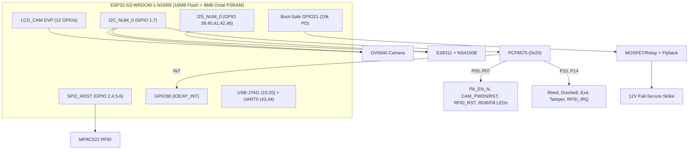

# Hardware Overview

## Core Bill of Materials (Rev A Reference)
| Subsystem | Part / Module | Interface | Role |
|---|---|---|---|
| **MCU Module** | **ESP32-S3-WROOM-1-N16R8** | Dual-core LX7 240 MHz, Wi-Fi 2.4 GHz, BLE 5.0, **16 MB Quad Flash**, **8 MB Octal PSRAM** | Main compute, networking, WebRTC, crypto |
| **RFID Transceiver** | **NXP MFRC522** (13.56 MHz) | `SPI2_HOST` (4 MHz default, max 10 MHz) + `PCF8575 P03` reset | ISO/IEC 14443-A/4 DESFire EV2/EV3 reader |
| **Camera Sensor** | **OmniVision OV5640** (5 MP, HW JPEG) | `LCD_CAM` 8-bit DVP + `I2C0` SCCB (`0x3C`) + `PCF8575` PWDN/RST | Live WebRTC MJPEG + HTTPS snapshots |
| **Audio Codec + Amp** | **ES8311 + NS4150B** Mono Module | `I2S_NUM_0` full-duplex + `I2C0` (`0x18`) + `PCF8575 P00` PA_EN_N | Mic input + 3 W mono speaker output |
| **I/O Expander** | **PCF8575** (16-bit I2C w/ `INT`) | `I2C0` (`0x20`) + `GPIO38` (`INT`) | Slow control outputs + debounced inputs |
| **Lock Actuator** | **12 V Fail-Secure Electric Strike / Solenoid** | Native `GPIO21` -> N-MOSFET / opto-relay + flyback diode | Physical door latching |
| **Door & UI Sensors** | Magnetic Reed, Doorbell Button, Exit Button, Tamper Switch | `PCF8575` Port 1 (`P10`–`P13`) with `INT` wake | Door state, visitor call, egress, anti-tamper |

## System Block Diagram

## Critical Hardware Design Notes
- **Octal PSRAM Pin Lockout:** On `ESP32-S3-WROOM-1-N16R8`, `GPIO33`–`GPIO37` are internally wired to Octal PSRAM and **must not be connected** to any external peripheral.
- **Fail-Secure Boot Guarantee:** `GPIO21` drives the lock stage through an external **10 kΩ pull-down** resistor so the strike stays de-energized (locked) during boot, brownout, or firmware crash.
- **PCF8575 Power-On Weak HIGH:** Because PCF8575 pins power up weakly HIGH (`0xFFFF`), Port 0 outputs use **active-low** wiring (or active-high `CAM_PWDN`, which powers the camera *down* at boot) and an inverted P-MOSFET/transistor stage for NS4150B `CTRL` so the speaker stays muted until firmware initializes ES8311.
