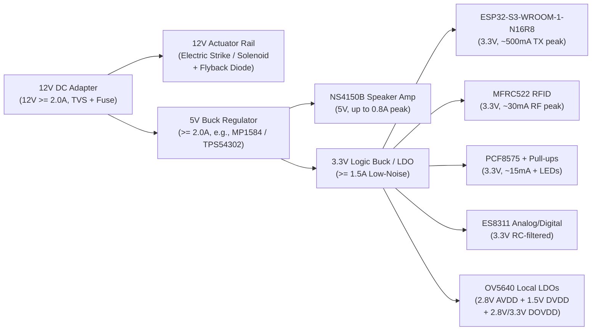

# Power Tree — Mains/DC Architecture (Rev A)

## Power Distribution Diagram

## Current Budget Estimate
| Rail / Load | Typical | Peak | Notes |
|---|---|---|---|
| **12 V Solenoid / Electric Strike** | 0 mA (locked) | 400–800 mA | Energized only during unlock window (5–15 s max) |
| **5 V -> NS4150B (4 Ω / 8 Ω speaker)** | 1 mA (muted) | 600–800 mA | Active only during intercom or voice prompts |
| **3.3 V -> ESP32-S3 (Wi-Fi + BLE + PSRAM)** | 120–180 mA | 500 mA | Wi-Fi TX bursts; add 220 µF + 10 µF + 0.1 µF near VDD |
| **3.3 V -> OV5640 Camera** | < 1 mA (PWDN) | 140 mA | Powered down via `CAM_PWDN` when idle |
| **3.3 V -> MFRC522 (RF active)** | 20–30 mA | 40 mA | Continuous 13.56 MHz polling |
| **3.3 V -> ES8311 + PCF8575 + LEDs** | 15 mA | 40 mA | Keep separate analog ground return for ES8311 mic |
| **Total 12 V Input Budget** | ~2.5 W idle | ~15 W peak (unlock + call + Wi-Fi TX) | Minimum **12 V / 2.0 A (24 W)** UL/CE-listed DC supply |

## Design Precautions
- **Brownout Prevention:** Isolate the 12 V solenoid ground return to a star ground near the input barrel jack/terminal block and place >= 470 µF bulk capacitance on 12 V and >= 220 µF on 3.3 V so solenoid inrush never trips ESP32-S3 brownout detection.
- **Audio Noise Isolation:** Power NS4150B from the 5 V rail (not 3.3 V) and feed ES8311 AVDD through a ferrite bead + 10 µF/0.1 µF filter to keep Wi-Fi TX buzz out of the microphone.
