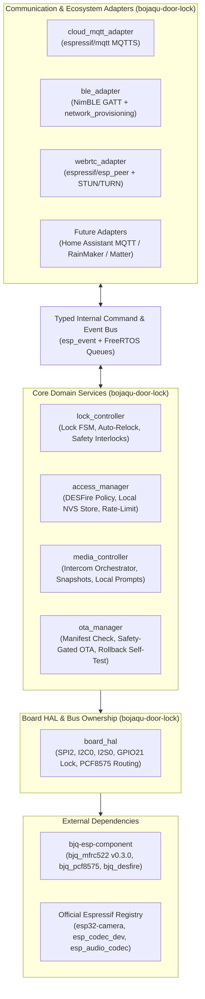

# Firmware Architecture — `bojaqu-door-lock`

## 1. Layered Architecture
Per [ADR-0001](../adr/0001-firmware-architecture.md), the firmware separates safety-critical physical access control from cloud/mobile transports and hardware drivers:



## 2. Planned Source Tree (`main/` & Local `components/`)
```text
bojaqu-door-lock/
├── CMakeLists.txt
├── CMakePresets.json              # dev & prod presets
├── partitions.csv                 # Custom 16 MB dual-OTA (2x 5 MB) layout
├── sdkconfig.defaults             # Shared ESP32-S3 + Octal PSRAM + 16 MB config
├── configs/
│   ├── dev/sdkconfig              # Bench / Wokwi / DEBUG / UID fallback allowed
│   └── prod/sdkconfig             # Secure Boot v2, Flash/NVS Enc, Anti-Rollback, WARN
├── main/
│   ├── idf_component.yml          # Official espressif/* + bjq-esp-component tags
│   ├── Kconfig.projbuild          # Product Kconfig (endpoints, RFID policy, timeouts)
│   └── main.c                     # Boot sequence, self-test, service startup
└── components/                    # Product-local modular components
    ├── bjq_lock_hal/              # Board pins, bus init, GPIO21 strike, PCF8575 glue
    ├── bjq_lock_core/             # Lock FSM, door/tamper monitor, auto-relock
    ├── bjq_access_mgr/            # DESFire/NVS credential store, enrollment, lockout
    ├── bjq_media_svc/             # Camera HAL, ES8311 audio prompts, WebRTC + snapshots
    ├── bjq_comms_mgr/             # Transport bus, MQTTS adapter, NimBLE GATT/prov
    └── bjq_ota_svc/               # Manifest poll, esp_https_ota, safety gate, self-test
```

## 3. Boot & Startup Sequence
1. **Early Hardware Safety:** Force `GPIO21` (`LOCK_ACTUATOR_EN`) LOW; initialize `I2C0` and `bjq_pcf8575` with fail-safe mask (`AUDIO_PA_EN_N=1`, `CAM_PWDN=1`, LEDs OFF).
2. **Storage & Identity:** Mount `nvs` (encrypted in `prod`) and read-only `fctry` NVS (X.509 mTLS cert/key, device ID, BLE PoP); mount `assets` and `storage` SPIFFS.
3. **Offline-First Access Ready (< 1 s):** Initialize `SPI2` + `bjq_mfrc522` + `bjq_desfire`, `lock_controller`, and `access_manager` so physical RFID and indoor exit unlock work immediately even before Wi-Fi associates.
4. **Connectivity & Provisioning:** Start Wi-Fi + SNTP + NimBLE; if unprovisioned, enter BLE Security 2 provisioning mode; otherwise connect MQTTS and start passive BLE offline-unlock service.
5. **OTA Pending-Verify Self-Test:** If booted from a new OTA slot (`ESP_OTA_IMG_PENDING_VERIFY`), confirm NVS + PCF8575 + MFRC522 `VersionReg` + Wi-Fi + MQTTS health within 60 s before calling `esp_ota_mark_app_valid_cancel_rollback()`.
