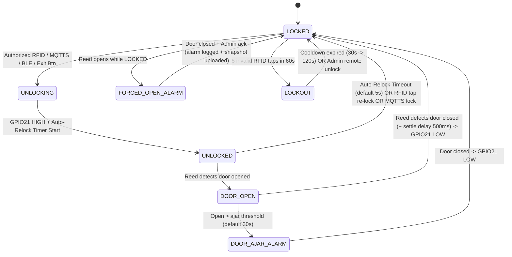
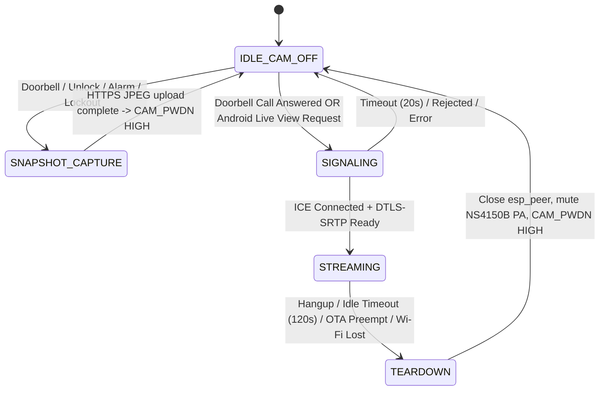
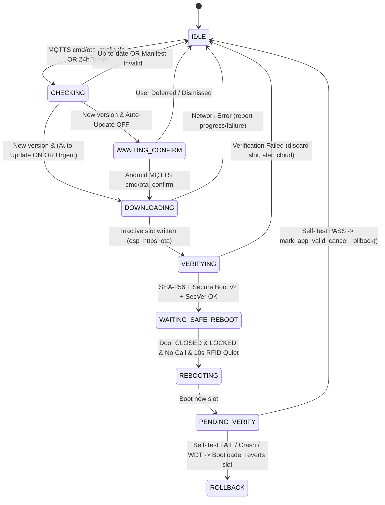

# State Machines

## 1. Lock Controller State Machine

### Hard Safety Invariants
- `GPIO21` (`LOCK_ACTUATOR_EN`) is driven LOW immediately when transitioning to `LOCKED`, `FORCED_OPEN_ALARM`, or `LOCKOUT`, and is hardware-clamped by a **15 s max solenoid energization watchdog** even if the door remains ajar.
- Physical **indoor exit button (`P12`)** always overrides `LOCKOUT` for life-safety egress.

## 2. Media / WebRTC Intercom State Machine

## 3. OTA Update State Machine

