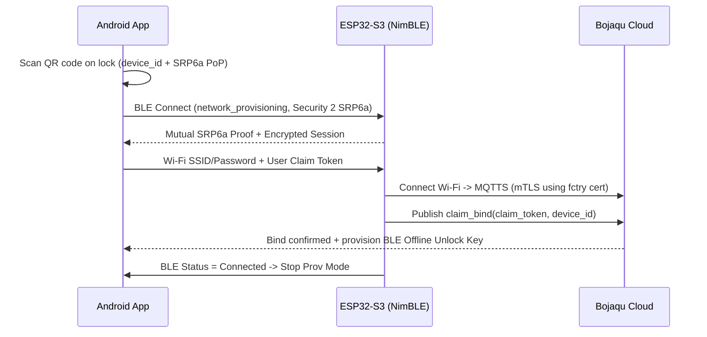
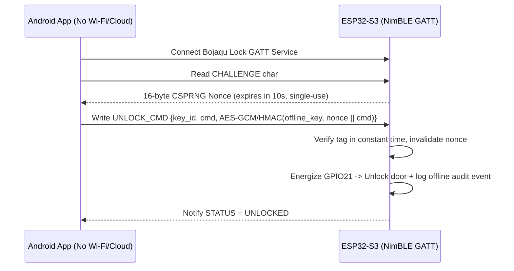
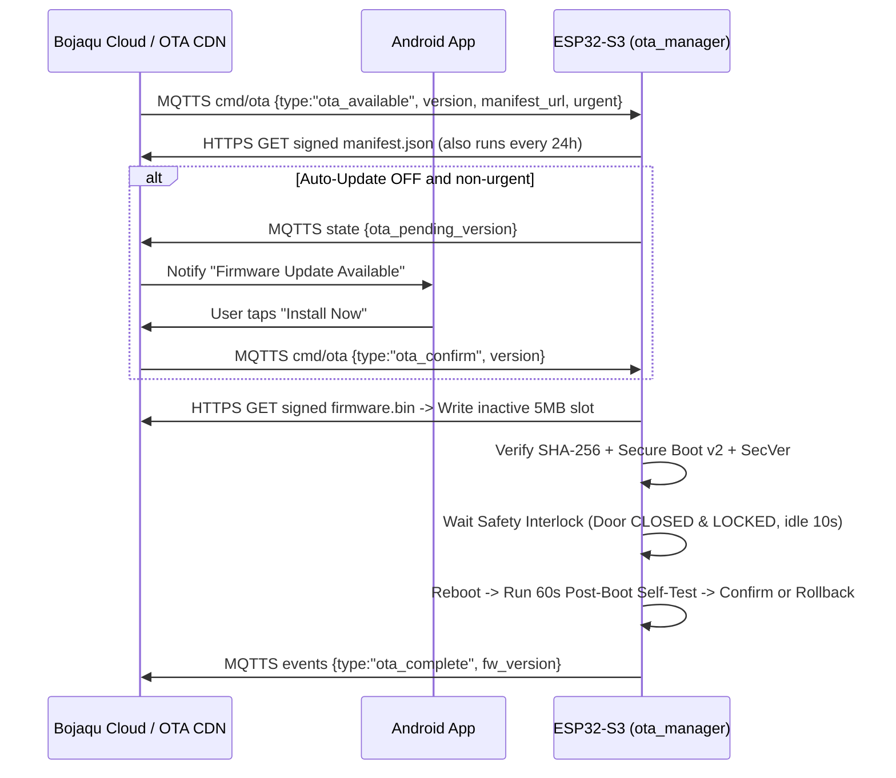

# Communication Breakdown & Protocol Workflow (Door-Lock <-> Cloud <-> Android)

This document breaks down every communication plane between `bojaqu-door-lock` (ESP32-S3), the Bojaqu Cloud Backend, and the **Android Mobile App**—plus how the transport adapter boundary enables future **Home Assistant**, **ESP RainMaker**, and **Matter** integrations (see [ADR-0003](../adr/0003-mobile-communication-and-control-plane.md) and [ADR-0004](../adr/0004-media-streaming-and-audio-architecture.md)).

## 1. Communication Planes Summary

| Plane | Path | Protocol & Security | Primary Use Cases |
|---|---|---|---|
| **Provisioning Plane** | Android <-> Lock (Direct) | **NimBLE** (`espressif/network_provisioning`, Security 2 SRP6a + QR PoP) | Initial Wi-Fi SSID/password setup, device claim/binding |
| **Offline Control Plane** | Android <-> Lock (Direct) | **NimBLE GATT** + Challenge-Response AES-GCM/HMAC | Nearby unlock/status when home Wi-Fi or cloud is offline |
| **Cloud Control & Telemetry Plane** | Lock <-> Cloud <-> Android | Lock: **MQTTS** (port 8883, X.509 mTLS, QoS 1, LWT); Android: HTTPS REST/WS + FCM Push | Remote lock/unlock, RFID card sync, door/tamper alerts, WebRTC signaling, OTA trigger |
| **Live Media Intercom Plane** | Lock <-> Android (P2P / TURN) | **WebRTC** (`espressif/esp_peer`, ICE/STUN/TURN, DTLS-SRTP, SCTP DataChannel) | On-demand OV5640 HW JPEG live video + ES8311/NS4150B two-way voice audio |
| **Bulk Transfer Plane** | Lock <-> Cloud Storage/CDN | **HTTPS** (TLS 1.2/1.3, mTLS / presigned URL, SHA-256 + Secure Boot v2) | Event JPEG snapshot upload & dual-bank OTA firmware download |

---

## 2. MQTTS Control & Telemetry Contract (Device <-> Cloud)

Base prefix: `bojaqu/v1/locks/{device_id}`

| Topic | Direction | QoS / Retain | Purpose |
|---|---|---|---|
| `.../status` | Device -> Cloud | QoS 1, Retained | Online/offline state (`{"online":true}` on connect; LWT `{"online":false}` on unexpected drop) |
| `.../state` | Device -> Cloud | QoS 1, Retained | Authoritative shadow state (`lock_state`, `door_closed`, `tamper`, `fw_version`, `rssi`, `ota_mode`) |
| `.../events` | Device -> Cloud | QoS 1, No Retain | Real-time events (`rfid_unlock`, `rfid_denied`, `remote_unlock`, `ble_unlock`, `doorbell_pressed`, `door_ajar`, `forced_open`, `tamper_alert`, `ota_progress`) |
| `.../cmd/lock` | Cloud -> Device | QoS 1 | Remote `unlock` / `lock` command (signed, expiring) |
| `.../cmd/rfid_sync` | Cloud -> Device | QoS 1 | Add/update/revoke DESFire card records or start 30 s card enrollment window |
| `.../cmd/webrtc_signal` | Bidirectional (`cmd/` & `events/`) | QoS 1 | WebRTC SDP offer/answer, ICE candidates, TURN creds, session hangup |
| `.../cmd/ota` | Cloud -> Device | QoS 1 | `ota_available`, `ota_confirm`, or `ota_policy_update` (`auto` vs `confirm`) |
| `.../ack` | Device -> Cloud | QoS 1 | Command execution result correlated by `request_id` |

### Security Envelope for Remote Unlock (`.../cmd/lock`)
```json
{
  "request_id": "0194b1e8-9c3d-7a2b-8f41-9d2a1c7f0011",
  "action": "unlock",
  "actor_id": "usr_8f2a10",
  "duration_s": 5,
  "iat": 1795692000,
  "exp": 1795692030,
  "sig": "<base64-ed25519-or-hmac-sha256-over-canonical-fields>"
}
```
Device validation rules before energizing `GPIO21`:
1. Verify `exp >= current_sntp_utc` and `exp - iat <= 60 s`.
2. Reject duplicate `request_id` (ring cache of last 32 processed IDs).
3. Verify cryptographic `sig` against device-bound cloud command verification key.
4. Emit `.../ack` with `status: "ok" | "rejected"` and publish updated `.../state` + `.../events`.

---

## 3. End-to-End Workflows

### 3.1 Initial BLE Provisioning & Cloud Binding


### 3.2 Visitor Doorbell -> Snapshot -> WebRTC Video/Audio -> Remote Unlock
```mermaid
sequenceDiagram
    participant Vis as Visitor at Door
    participant Lock as ESP32-S3 Lock
    participant Cloud as Bojaqu Cloud (MQTT/HTTPS/FCM)
    participant App as Android App

    Vis->>Lock: Press Doorbell Button (PCF8575 P11 -> INT GPIO38)
    Lock->>Lock: Play local doorbell chime (ES8311/NS4150B)
    Lock->>Lock: Wake OV5640 -> Capture SVGA JPEG snapshot
    Lock->>Cloud: HTTPS POST snapshot JPEG -> snapshot_url
    Lock->>Cloud: MQTTS events {type:"doorbell_pressed", snapshot_url}
    Cloud->>App: High-Priority FCM Push (Visitor notification + thumbnail)

    App->>Cloud: Answer Call -> Request STUN/TURN creds & start WebRTC
    Cloud->>Lock: MQTTS cmd/webrtc_signal {type:"start", session_id, ice_servers}
    Lock->>Cloud: MQTTS events/webrtc_signal {type:"offer", sdp}
    Cloud->>App: Forward SDP Offer
    App->>Cloud: Send SDP Answer + ICE Candidates
    Cloud->>Lock: MQTTS cmd/webrtc_signal {type:"answer", sdp, candidates}

    Note over Lock,App: Direct P2P (or TURN) DTLS-SRTP + DataChannel Established
    Lock-->>App: OV5640 HW JPEG Stream (VGA 640x480 @ 10-15fps)
    Lock<-->App: Full-Duplex ES8311/NS4150B <-> Android Voice (Opus/G.711 SRTP)

    App->>Cloud: User taps "Unlock Door"
    Cloud->>Lock: MQTTS cmd/lock {action:"unlock", request_id, exp, sig}
    Lock->>Lock: Energize GPIO21 (fail-secure strike) + Voice prompt "Unlocked"
    Lock->>Cloud: MQTTS ack + state {lock_state:"unlocked"}
```

### 3.3 Offline Nearby Unlock (NimBLE GATT Challenge-Response)

When Wi-Fi reconnects, offline BLE and RFID audit logs stored in `storage` SPIFFS flush automatically to `.../events`.

### 3.4 OTA Firmware Update Workflow


---

## 4. Future Ecosystem Adapter Mapping (Post-v1)
Because core services consume internal `lock_cmd_t` and emit `lock_event_t`:
- **Home Assistant:** Add `ha_mqtt_adapter` publishing Home Assistant MQTT Discovery payloads (`homeassistant/lock/{id}/config`, `binary_sensor/{id}_door/config`, `binary_sensor/{id}_tamper/config`) over the existing `espressif/mqtt` stack.
- **ESP RainMaker:** Add `rmaker_adapter` mapping RainMaker Lock/Door params onto `lock_cmd_t`/`lock_event_t`.
- **Matter over Wi-Fi:** Add `matter_adapter` exposing the Matter Door Lock Cluster (`0x0101`) inside the 5 MB OTA app headroom.
